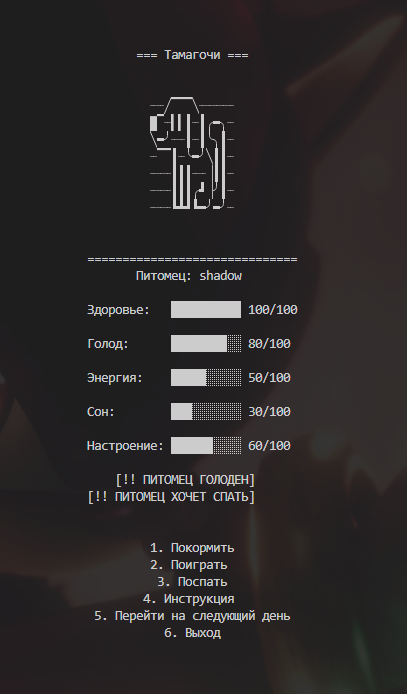

# Pet Tamagochi Game

**Pet Paradise** is a console-based virtual pet game written in Python. The player takes care of a cat or a dog by feeding, playing with, and letting the pet sleep.

I created this project as my Python final exam project to practice object-oriented programming and apply what I had learned in a larger application.

## Features

- Choose between a cat and a dog.
- Take care of your pet's health, hunger, energy, sleep, and mood.
- Feed your pet using different types of food.
- Play mini-games with your pet.
- Experience random events that affect your pet's stats.
- Two animals react to your actions differently, so be careful!
- Save and load game progress using JSON.
- Navigate through a console-based menu.

## Technologies

- **Python 3**
- **Object-Oriented Programming (OOP)**
- **JSON** for saving and loading progress
- **Python standard libraries:** `os`, `shutil`, `random`, `time`, `msvcrt`

## What I learned

While working on this project, I practiced:

- Classes, inheritance, and abstract classes.
- Encapsulation using private attributes and getters/setters.
- Polymorphism through different pet behaviors.
- Functions, loops, and conditional statements.
- Working with files and JSON data.
- Splitting code into separate modules.
- Implementing game mechanics and handling user input.
- Debugging and testing different gameplay scenarios.

## How to run

1. Make sure Python 3 is installed.
2. Clone this repository:
   ```bash
   git clone YOUR_REPOSITORY_URL
   ```
3. Open the project folder.
4. Run the game:
   ```bash
   python main.py
   ```

## Project structure

```text
Pet-Paradise/
├── main.py
├── modules/
│   ├── animals.py
│   ├── mini_games.py
│   ├── events.py
│   ├── save_game.py
│   └── text.py
├── instruction.txt
└── README.md
```

## About the project

Pet Paradise started as a way to practice Python, but it grew into a larger project where I could combine different programming concepts into one application.

My main goal was to make the game playable while keeping the code organized and easy to work with.


